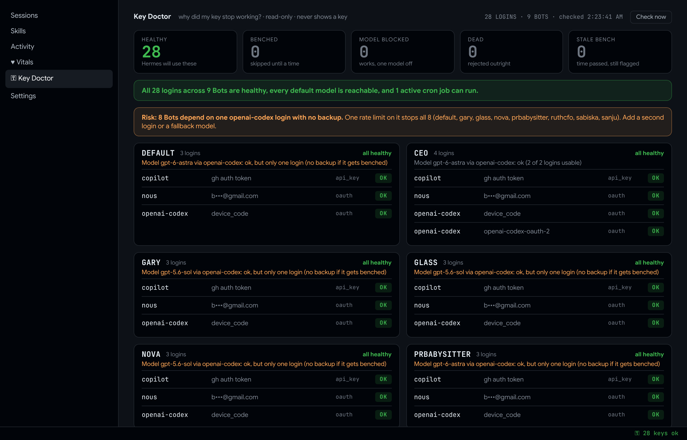

# Hermes Key Doctor

**`hermes auth status` says "logged in". Your Bot says "no credentials found".**

Or a valid Anthropic key fails with *"credit balance too low"*. Or the `/model` picker collapsed overnight, or a cron job stopped. Hermes quietly **benches** a login after a rate limit, a billing error or a model the account isn't entitled to, and nothing on screen says so.

Key Doctor checks every login in every Hermes profile and tells you **what's wrong, why, until when, and the one command that fixes it**. It reads through Hermes's own credential code, so the times are the ones Hermes enforces. It is **read-only and never prints a key**.



<sub>A real reading of the author's 9 Bots. Emails are masked on screen.</sub>

## Install

```bash
hermes plugins install BkashJEE/hermes-key-doctor --enable
# then switch on its Desktop page in Hermes Desktop: Capabilities → Plugins
```

One-click from a browser or a web page (Hermes Desktop asks you to confirm first):

```text
hermes://plugin/install?repo=BkashJEE/hermes-key-doctor&enable=1
```

You get a **Key Doctor** page (sidebar and ⌘K) with a status-bar chip (`⚿ 28 keys ok`, red when something needs attention), the `hermes keydoctor` command (`--json`, `--alert`) and the `/keys` chat command. Or just ask any Bot: *"Check my logins: is anything benched?"*

## What it checks

| You see | What it means | The fix it gives you |
|---|---|---|
| **BENCHED** | Hermes skips this login until the time shown, after a 429 rate limit, 402 billing or 403 entitlement error | `hermes -p <bot> auth reset <provider> <id>` (OAuth: `auth refresh`) |
| **MODEL BLOCKED** | The login works, but one model is blocked on it. Longer than a week means the stuck-cooldown bug ([#127917](https://github.com/NousResearch/hermes-agent/issues/127917)) | `auth reset` |
| **DEAD** | The provider rejected the login outright | remove it and add it again |
| **STALE BENCH** | Marked exhausted, but the time has passed | `auth reset` makes sure Hermes retries it |
| **EXPIRING / EXPIRED** | A sign-in with no refresh token, so it can't renew itself. Warned 24 h ahead | sign in again: `auth add <provider> --type oauth` |
| **WRONG AUTH MODE** | An Anthropic Console key (`sk-ant-usr` / `sk-ant-svc`) that Hermes sends as a subscription token. Anthropic answers "credit balance too low" on a fine key ([#133856](https://github.com/NousResearch/hermes-agent/issues/133856)) | add a standard `sk-ant-api` key with `--type api-key` |
| **.env billing trap** | `ANTHROPIC_API_KEY` in a Bot's `.env` next to a subscription login: Hermes can bill the paid API instead ([#97085](https://github.com/NousResearch/hermes-agent/issues/97085)) | remove it from `.env` if that isn't what you want |
| **DEFAULT MODEL BLOCKED** | The Bot's own model has no usable login: this *is* "no credentials found" (it says so when a `fallback_model` covers it) | the fix for the blocking login |
| **CRON WILL FAIL** | An active cron job's model has no usable login, with the job and its next run | the fix for the blocking login |
| **RISK: no backup** | Several Bots run on one login with nothing to rotate to: one rate limit stops all of them | add a second login or a `fallback_model` |
| **shared ×N** | The same login is in several Bots | one fix clears all of them |

Every fix names its profile with `-p`, because a plain `hermes` follows `~/.hermes/active_profile`. Key Doctor never runs a fix itself; it shows you the command.

## Daily watchdog

Silent when every login is healthy, a short Telegram message when not:

```bash
hermes -p default cron create "10 9 * * *" --name key-doctor-daily --script key-doctor-alert.py --no-agent --deliver telegram
```

## Skill only (no plugin)

```bash
git clone https://github.com/BkashJEE/hermes-key-doctor && cd hermes-key-doctor
cp skills/key-doctor/scripts/key_doctor.py ~/.hermes/scripts/key-doctor.py
cp skills/key-doctor/scripts/key_doctor_alert.py ~/.hermes/scripts/key-doctor-alert.py
mkdir -p ~/.hermes/skills/key-doctor && cp skills/key-doctor/SKILL.md ~/.hermes/skills/key-doctor/
~/.hermes/hermes-agent/venv/bin/python ~/.hermes/scripts/key-doctor.py
```

## Privacy and limits

- Read-only. It reads Hermes's credential pool through Hermes's own code and never writes it.
- Keys are never printed or stored. Anthropic keys are judged by their prefix only; from `.env` it reads variable names, never values.
- It sees what Hermes recorded. It can't know your remaining credit or quota.

## Tests

```bash
python3 -m unittest tests/test_key_doctor.py
```

Related upstream issues: NousResearch/hermes-agent#132817, #136687, #133856, #127917, #128995, #97085. See [CHANGELOG.md](CHANGELOG.md). MIT licensed.
